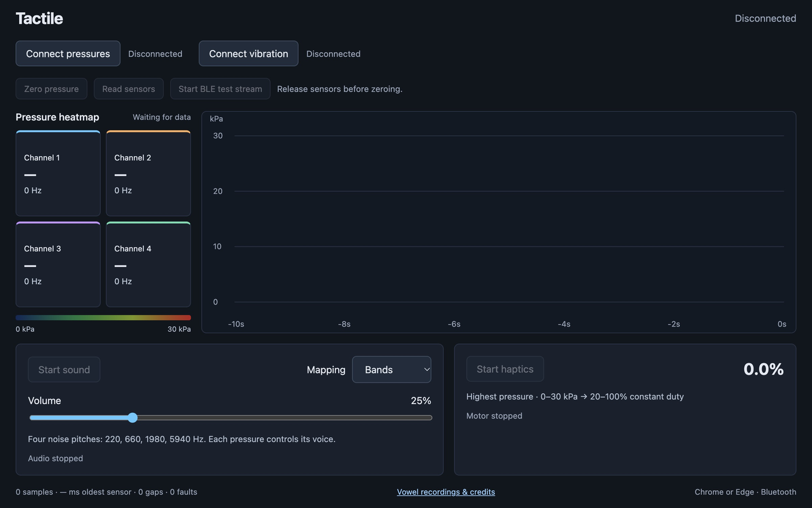

# Tactile

[Open Tactile](https://qwertpas.github.io/tactile/) in your browser with Bluetooth enabled.

View pressure readings and control sound and vibration from connected Tactile devices.

1. Power on your devices.
2. Click **Connect pressures** and choose **Tactile Pressure**.
3. For vibration feedback, click **Connect vibration** and choose **Tactile Vibration**.
4. Release all pressure inputs, then click **Zero pressure**.
5. Click **Start sound** and/or **Start haptics**. Use the same buttons to stop.

Choose a sound mapping and adjust **Volume** as needed. **Read sensors** restarts live readings; **Start BLE test stream** uses test data from the connected pressure device.

Keep the page visible while using feedback. If readings stop, reconnect and zero again.
